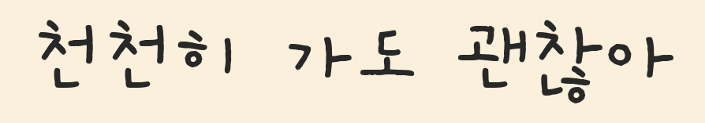

# hangul-font-finder

[](https://huggingface.co/prenny/hangul-font-finder)
[](https://huggingface.co/prenny/hangul-font-finder)
[](https://github.com/habaekk/hangul-font-finder/stargazers)
[](LICENSE)
<br>
[](https://www.python.org/)
[](https://pytorch.org/)
[](https://huggingface.co/google/siglip2-base-patch16-224)
[](#results)
[](#results)

한글 텍스트 한 줄 이미지에서 사용된 무료 한글 폰트를 식별하는 모델입니다.

- 무료 한글 폰트 1,276종 식별 (1,393 패밀리, [전체 목록](FONTS.md))
- 외곽선, 그림자, 입체, 그라데이션, 장평 변형, 부분 가림, 저해상도·압축 이미지 대응
- 글자 이미지 하나로 추론
- 폰트일 확률 출력
- 합성 데이터로 학습

| Input | Top-1 | Prob. |
|---|---|---:|
|  | Black Han Sans (검은고딕) | 0.996 |
|  | Jua (배달의민족 주아) | 0.996 |
|  | Do Hyeon (배달의민족 도현) | 0.994 |
|  | Gaegu (개구쟁이) | 0.997 |
|  | Song Myung (송명) | 0.997 |
|  | Yeon Sung (배달의민족 연성) | 0.997 |

## Installation

```bash
git clone https://github.com/habaekk/hangul-font-finder
cd hangul-font-finder
pip install -r requirements.txt
```

가중치(376MB)는 첫 실행 시 Hugging Face에서 자동으로 내려받습니다.

## Usage

```bash
python inference.py line.png --top 5
```

```python
from PIL import Image
from inference import FontIdentifier

model = FontIdentifier()
model.predict(Image.open("line.png"), top=5)
# [{'font': 'Jua', 'same_shape_fonts': ['BM JUA_TTF', 'Jua'],
#   'korean_name': '배달의민족 주아', 'probability': 0.9955}, ...]
```

- 입력은 텍스트 한 줄을 잘라 낸 이미지입니다. 텍스트 검출은 포함하지 않습니다.
- 한글 자형이 같은 폰트(OTF/TTF, 영문/한글 이름, Google Fonts 판)는 하나로 묶어 반환하며, `same_shape_fonts`에 전체 이름을 표시합니다.
- CUDA, MPS, CPU를 지원합니다.

## Results

| Test set | Lines | Top-1 | Top-3 | Top-5 |
|---|---:|---:|---:|---:|
| Hard (mixed effects) | 2,702 | 93.3% | 97.9% | 98.7% |
| Clean | 1,351 | 97.4% | ≥ 99.2% | ≥ 99.8% |

확률이 0.95 이상인 예측은 전체의 84%이며, 정확도는 99.6%입니다.

## Limitations

- 학습한 1,276종 밖의 폰트는 가장 비슷한 폰트로 답합니다. 이 경우 확률이 낮게 나옵니다.
- 모든 수치는 합성 이미지 기준입니다.
- 한글 위주이며, 영문·숫자만 있는 줄은 평가하지 않았습니다.
- 모델은 폰트 이름만을 제공합니다. 폰트의 사용 가능 여부는 각 라이선스를 확인하세요.

## License

[MIT](LICENSE). 가중치는 [SigLIP 2](https://huggingface.co/google/siglip2-base-patch16-224)(Apache-2.0)를 파인튜닝한 것입니다. [LICENSE-SIGLIP2-APACHE-2.0](LICENSE-SIGLIP2-APACHE-2.0), [NOTICE](NOTICE) 참고.
